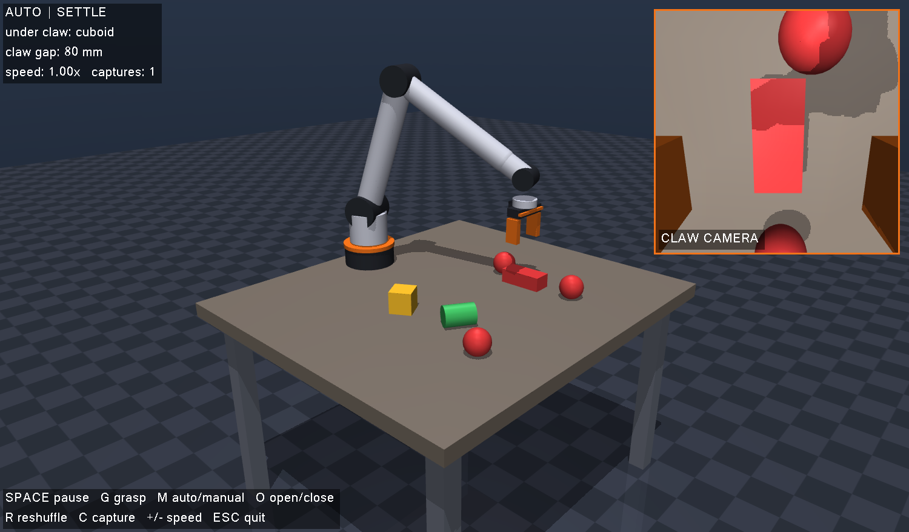
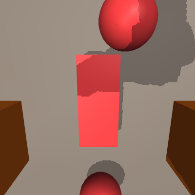
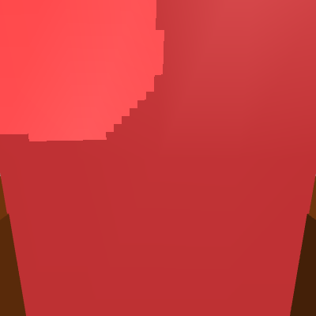
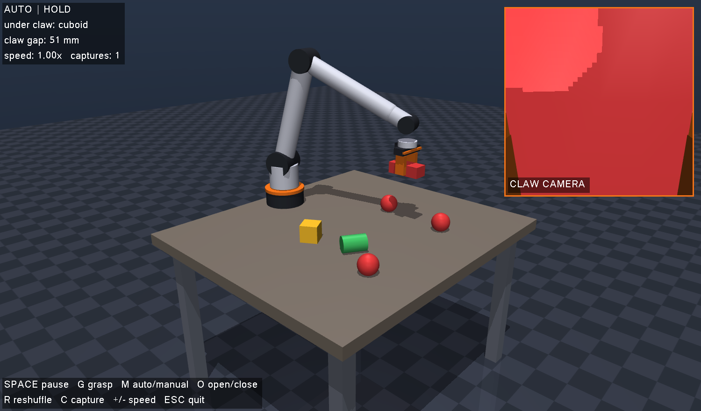
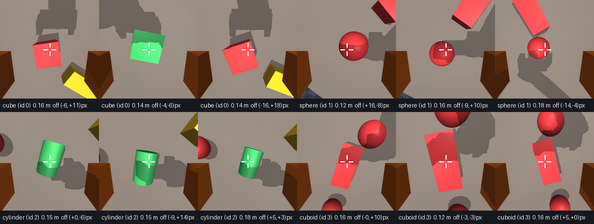

# Eye-in-Hand Claw: Object Classification Testbed


A simulated 6-DoF arm with a **two-finger claw** and a **camera mounted on the claw
itself**. The arm runs a continuous inspect-and-pick cycle over a table of objects:
hover, look, classify, grip, lift, set down, move on. Everything the camera sees is
labelled automatically.

## Why not just use the overhead camera?

The standard laboratory setup mounts a **fixed camera above the workspace** and does object
detection from it. It works, but it has three structural weaknesses, and all three get
worse exactly when the robot is doing its job:

1. **The arm occludes its own target.** As the manipulator reaches in, it comes between
   the fixed camera and the object. The view degrades precisely at the moment the robot
   needs it most.
2. **It requires hand-eye calibration.** Detections arrive in camera coordinates and have
   to be transformed into the robot's frame. That transform has to be measured, and it
   drifts whenever the camera or the robot is moved or knocked.
3. **One viewpoint, fixed forever.** Object scale and pose in the image are dictated by
   where the camera happens to be bolted, not by what would make the object easiest to
   recognise. A flat object seen edge-on from above stays edge-on.

Mounting the camera **on the claw** removes all three. The robot sees each object from its
own perspective, from the approach direction, at the moment it commits to picking it up —
so it *sees what it picks, every time*. There is nothing to calibrate, because the camera
is rigidly fixed to the tool frame and its pose is a known function of the joint angles.
And the viewpoint is chosen by the controller: the arm can move to whatever standoff
distance and angle makes recognition easiest.

The trade is that classification becomes harder. With a fixed camera the viewpoint is
constant and the classifier only has to handle object variation. With an eye-in-hand
camera the viewpoint is a function of the robot's own configuration, so scale, viewing
angle and occlusion all change as the arm moves. **This repository is the testbed for
measuring how much that costs, and for generating the data to train against it.**



*The claw hovering over an object, with its own camera view live in the panel on the
right. Both finger pads frame the object; the status readout names what the optical axis
is currently pointing at.*

---

## Key Numbers

| Quantity | Value |
|---|---|
| Manipulator | 6-DoF revolute arm + parallel two-finger claw |
| Claw | 80 mm open, 40 mm stroke per finger, force-limited position control |
| Inverse kinematics | Analytic seed + damped least squares, **5.8 mm** mean tool error |
| Optical-axis alignment | **0.64°** mean deviation from vertical while inspecting |
| Claw camera | 224 × 224 RGB, 72° FOV, rigidly mounted on the palm |
| Object classes | 4 (cube, sphere, cylinder, cuboid) |
| Objects per layout | 6, on a jittered 3 × 2 grid |
| Label source | Renderer segmentation buffer — **exact, zero manual annotation** |
| Auto-label agreement | **6/6** objects correctly identified |
| Grasp success | **6/6** objects gripped and lifted clear of the table |
| Target centring | **13.1 px** mean offset from image centre (of a 112 px half-width) |
| Inspect-and-pick cycle | 7.65 s per object |
| Speed | 1.7 × real time on CPU |

---

## System Architecture

```
                        ┌──────────────────────────────────┐
                        │   MJCF scene (built in Python)   │
                        │  floor · table · 6-DoF arm ·     │
                        │  two-finger claw · 6 objects     │
                        └────────────────┬─────────────────┘
                                         │
        ┌────────────────────────────────┼────────────────────────────────┐
        │                                │                                │
┌───────▼────────┐              ┌────────▼────────┐            ┌──────────▼─────────┐
│ Grasp planner  │              │ MuJoCo physics  │            │ Interactive viewer │
│ longest axis → │              │ step @ 500 Hz   │            │ orbit · zoom · pan │
│ claw yaw       │              │                 │            │ + claw-POV panel   │
│ 2nd axis →     │              └────────▲────────┘            └────────────────────┘
│ finger opening │                       │
└───────┬────────┘                       │
        │                                │
┌───────▼────────────────────┐           │
│ Cycle controller           │           │
│ approach → settle →        │  ctrl     │
│ descend → close → lift →   │───────────┘
│ hold → lower → release →   │  (6 joint + 2 finger setpoints)
│ retreat                    │
└───────┬────────────────────┘
        │                    ▲
        │  Cartesian goal    │ joint angles
        └────────────────────┤
                    ┌────────┴─────────┐
                    │ Inverse kinematics│
                    │ analytic seed +   │
                    │ DLS polish (6D)   │
                    └───────────────────┘
                                         │  arm configuration
                                         ▼
                        ┌──────────────────────────────────┐
                        │  Claw camera (eye-in-hand)       │
                        │  pose = f(joint angles)          │
                        └────────────────┬─────────────────┘
                                         │
                ┌────────────────────────┴────────────────────────┐
                │                                                 │
       ┌────────▼────────┐                              ┌─────────▼─────────┐
       │  RGB  224×224   │                              │ Segmentation map  │
       │  → frame_N.png  │                              │ → centre-patch    │
       └────────┬────────┘                              │   ground truth    │
                │                                       └─────────┬─────────┘
                └──────────────────┬──────────────────────────────┘
                                   ▼
                     data/captures/  +  labels.jsonl
              (image, class_id, pose, hover height, centring error)
                                   │
                                   ▼
                        [ NEXT STAGE: CNN classifier ]
```

---

## Run It

```bash
pip install -r requirements.txt
python run_sim.py
```

A window opens with the arm already working through the objects.

| Input | Action |
|---|---|
| Left drag | Orbit the scene |
| Right drag | Pan |
| Scroll | Zoom |
| `Space` | Pause / resume the cycle |
| `G` | Toggle pick-and-place ↔ inspect only |
| `M` | Toggle AUTO ↔ MANUAL (arm holds still) |
| `O` | Open / close the claw by hand, in MANUAL mode |
| `R` | Reshuffle the object layout |
| `C` | Save the current claw-camera frame, auto-labelled |
| `+` / `-` | Speed the cycle up or down |
| `Esc` | Quit |

Other entry points:

```bash
python run_sim.py --no-grasp       # inspect only, never pick anything up
python run_sim.py --capture        # also save a labelled frame at every inspection
python run_sim.py --ui             # MuJoCo's stock UI, with a slider per joint
python run_sim.py --dataset 500    # headless: generate 500 auto-labelled frames
python run_sim.py --selftest       # verify IK, labelling and grasping
python run_sim.py --seed 7         # a different object layout
```

---

## The Inspect-and-Pick Cycle

Each object gets the same eight-phase cycle:

| Phase | Duration | What happens |
|---|---|---|
| `approach` | 1.70 s | Traverse to the hover pose, claw open, yaw aligned to the object |
| `settle` | 0.85 s | Hold still — **the classification frame is captured here** |
| `descend` | 0.80 s | Lower the open claw around the object |
| `close` | 0.60 s | Squeeze to the planned opening |
| `lift` | 0.90 s | Raise the object 0.20 m clear of the table |
| `hold` | 0.80 s | Present it to the camera |
| `lower` | 0.90 s | Put it back |
| `release` | 0.50 s | Open |
| `retreat` | 0.60 s | Withdraw to the hover pose, move to the next object |

The classification frame is deliberately taken at `settle`, **before** the grasp. That is
the decision point for a real system — it must know what the object is in order to choose
how to grip it. It is also the only viewpoint that frames the whole object: once an
object is in the claw it sits ~56 mm from the lens and overflows the frame.

| Before the grasp (`settle`) | Held in the claw (`hold`) |
|---|---|
|  |  |
| The classification viewpoint — object centred, both pads in frame | Useful as a demo, useless as training data |



*The same cycle three phases later: the claw has closed to 51 mm on the cuboid and lifted
it clear of the table. The camera panel is now filled by the object it is holding.*

### Grasp planning

The claw closes along one axis, so it has to be yawed across the object's narrow
dimension. The planner projects each of the object's three body axes — scaled by its
half-size — onto the table plane, takes the longest projection as the object's long axis,
and yaws the claw perpendicular to it. The second-longest projection gives the width the
fingers must span, and the commanded opening is that width minus a 9 mm squeeze.

| Class | Planned opening |
|---|---|
| cube | 60 mm |
| sphere | 66 mm |
| cylinder (resting on its side) | 51 mm |
| cuboid | 52 mm |

---

## Scene

| Element | Detail |
|---|---|
| Table | 0.92 × 1.04 m surface at 0.62 m |
| Arm mount | On the table surface, at the rear edge |
| Link lengths | 0.400 m upper arm, 0.360 m forearm, 0.078 m wrist offset |
| Joint set | base yaw · shoulder · elbow · wrist roll · wrist pitch · tool yaw |
| Claw pads | 68 mm long, condim-4 contact, friction 1.8 |
| Object field | 3 × 2 grid, ±30 mm jitter, random yaw |
| Inspection height | 0.15 m (grasp frame above the table) |

### Classes

| id | Class | Geometry | Dimensions (m) |
|---|---|---|---|
| 0 | `cube` | box | 0.060 × 0.060 × 0.060 |
| 1 | `sphere` | sphere | r = 0.033 |
| 2 | `cylinder` | cylinder | r = 0.028, h = 0.080 |
| 3 | `cuboid` | box | 0.120 × 0.052 × 0.040 |

**Colour is sampled independently of class.** A cube may be red, green or purple with
equal probability, so a classifier cannot reach high accuracy by learning colour — shape
is the only class-carrying signal. This is a deliberate design decision: colour shortcuts
are one of the most common ways a tabletop-classification result fails to survive contact
with real data.

---

## Data Generation

Every captured frame is labelled from the renderer's **segmentation buffer**, not by hand.
The label is whatever geom dominates the centre patch of the image, mapped back to its
class. Annotation is exact, free, and scales to any number of frames.

```bash
python run_sim.py --dataset 500
```

writes to `data/captures/`:

```
frame_00000.png          224×224 RGB from the claw camera
...
labels.jsonl             one JSON record per frame
```

Each record:

```json
{"file": "frame_00000.png", "class_id": 1, "class_name": "sphere",
 "colour_rgb": [0.86, 0.22, 0.22], "object_xyz": [0.453, 0.192, 0.650],
 "image_size": [224, 224], "layout_seed": 42,
 "hover_height_m": 0.1178, "centre_offset_px": [15.7, -7.5]}
```

`centre_offset_px` records how far the labelled object's centroid sits from the image
centre, so the dataset carries evidence of its own framing quality rather than requiring
it to be taken on trust. Across a 48-frame run: **mean 13.1 px, median 12.9 px, max
30.1 px** against a 112 px half-width.



*Three auto-labelled frames per class. The crosshair marks the image centre; each caption
gives the inspection height and the measured centring error.*

Viewpoint is varied per frame — inspection height sampled over 0.11–0.18 m, claw yaw
perturbed by ±0.4 rad, target jittered ±15 mm — so the same object is seen at a range of
scales and orientations. The layout is reshuffled every 12 frames.

Class distribution from a 48-frame run (seed 42):

| Class | Frames | Share |
|---|---|---|
| cube | 9 | 18.8 % |
| sphere | 12 | 25.0 % |
| cylinder | 11 | 22.9 % |
| cuboid | 16 | 33.3 % |
| background | 0 | 0.0 % |

The distribution is not uniform because classes are sampled per layout slot. Balancing is
handled at dataset-assembly time, not by biasing the simulator.

---

## Verification

`python run_sim.py --selftest` drives the claw over every object in turn, inspects it,
then grips and lifts it — reporting tool accuracy, label agreement and grasp success:

```
    cuboid    pos err   5.0 mm | axis 0.59 deg | sees cuboid    OK | grasp width 52.0 mm, lifted +175.1 mm OK
    sphere    pos err   3.8 mm | axis 0.51 deg | sees sphere    OK | grasp width 66.0 mm, lifted +159.7 mm OK
    cylinder  pos err   5.7 mm | axis 0.66 deg | sees cylinder  OK | grasp width 51.0 mm, lifted +167.8 mm OK
    sphere    pos err   9.2 mm | axis 0.86 deg | sees sphere    OK | grasp width 66.0 mm, lifted +160.6 mm OK
    cube      pos err   3.1 mm | axis 0.44 deg | sees cube      OK | grasp width 60.0 mm, lifted +165.2 mm OK
    sphere    pos err   8.3 mm | axis 0.81 deg | sees sphere    OK | grasp width 66.0 mm, lifted +160.5 mm OK

  mean IK position error : 5.8 mm
  mean optical-axis error: 0.64 deg
  auto-label agreement   : 6/6
  successful grasps      : 6/6
```

The residual few millimetres are steady-state tracking error of the position-controlled
joints under gravity, not IK error — the IK solution itself converges to under 0.1 mm.

### Two problems that were worth solving properly

**The IK gets trapped without a good seed.** A naive damped-least-squares solver seeded
from the current pose runs into the elbow joint limit for most targets in this workspace:
it converged to ~194 mm mean error and left the optical axis 60° off vertical. The solver
here first computes a **closed-form seed** — with the optical axis constrained to vertical,
the arm reduces to a planar 2R chain plus a wrist pitch that absorbs the remaining angle —
and evaluates both elbow branches and both wrist branches, polishing each with DLS and
keeping the best. Later solves warm-start from the previous solution, which keeps the
per-step cost low enough to run above real time.

**A side-mounted camera only centres objects at one height.** The camera sits 36 mm to
one side of the palm and is tilted back towards the tool axis, so its optical axis crosses
that axis at exactly one depth. Hovering straight above an object therefore centres it at
one inspection height and nowhere else — at 0.24 m the target drifted 32 mm off axis.
Instead of hovering above the object, the controller solves for the lateral offset that
puts the object *on* the optical axis at the current height, and undoes that offset before
descending so grasping is unaffected. Centring error dropped from tens of millimetres to
a mean of 3.2 px across inspection heights from 0.13 m to 0.24 m.

---

## Limitations & Future Work

1. **No domain randomisation.** Lighting, table texture and camera intrinsics are fixed. A
   classifier trained on this data would almost certainly not transfer to a real claw
   camera. Randomising lighting direction and intensity, surface texture, and adding
   sensor noise and motion blur is the necessary next step before any sim-to-real claim.
2. **Geometric primitives, not real objects.** Four primitives prove the pipeline, not the
   task. Replacing them with scanned meshes of everyday objects (mug, bottle, remote,
   spoon) is required before the classification problem is representative of a real
   picking workcell.
3. **Clutter in frame.** At a 72° FOV and 0.13 m grid spacing, neighbouring objects appear
   at the edges of most frames. The labelled object is reliably centred (see
   `centre_offset_px`), but frames are not clean single-object crops. Recording per-frame
   bounding boxes for *every* visible object is the fix.
4. **Grasping is open-loop.** The claw closes to a width computed from ground-truth object
   geometry, which a real system would not have. Closing on force feedback, or predicting
   the opening from the camera image, is the honest version of this.
5. **No classifier yet.** This repository produces data and demonstrates the closed loop
   from joint angles to a labelled image. Training and benchmarking — CNN versus classical
   shape descriptors + SVM, per-class precision/recall/F1, k-fold cross-validation — is
   the next milestone.
6. **Rigid-body contact only.** Objects are rigid primitives with idealised friction. No
   deformables, no slip modelling.

---

## Where This Fits

The end goal is a manipulator that identifies objects using only the sensors carried on
the robot itself, and acts on that identification — no external camera rig, no hand-eye
calibration step, no separate perception station.

This repository builds that loop end to end: a camera that moves with the arm, exact
ground truth for supervision, a grasp planned from the recognised object's geometry, and a
reproducible pipeline running from robot configuration to labelled observation. What it
does not yet have is the classifier in the middle — the data pipeline exists so that the
classifier can be trained and, more importantly, so that eye-in-hand recognition can be
benchmarked honestly against the fixed-camera baseline it is meant to replace.

The natural next experiment falls straight out of the setup: render the same objects from
a simulated fixed overhead camera, train the same classifier on both, and measure the
accuracy gap. That number is the real cost of moving the camera onto the arm, and it is
what justifies — or refutes — the whole approach.

---

## Author

**Yugandhar Kulkarni** — DRDO Research Intern · BTech CSE, DES Pune University
GitHub: [github.com/yugandhar-k](https://github.com/yugandhar-k)

---

## Reproducibility

Everything is seeded (`--seed`, default 42). The MJCF scene is generated in Python rather
than loaded from a static file, so link lengths, claw geometry, the object field and the
class taxonomy are all named constants at the top of `run_sim.py`. The arm's planar link
lengths and the camera mounting offsets are *measured back out of the compiled model* when
the solver and the framing correction are set up — retuning the geometry does not silently
break either.
