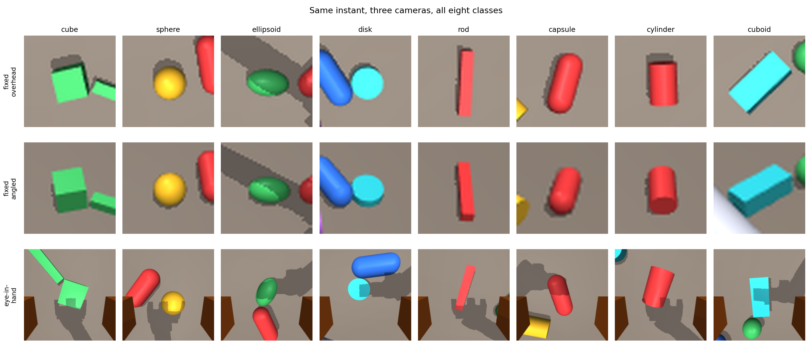
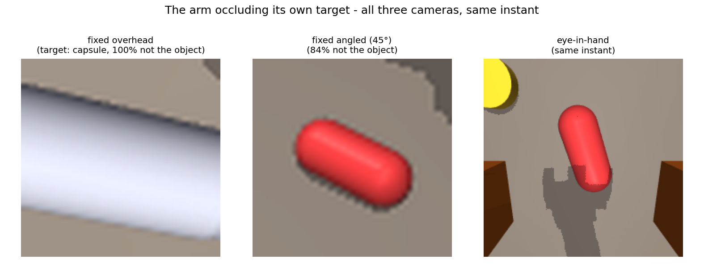
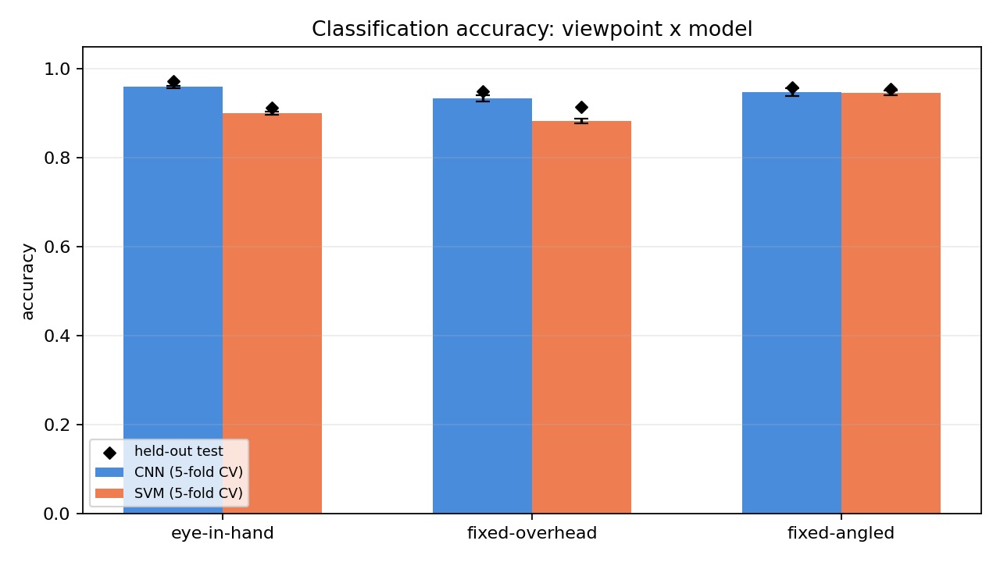
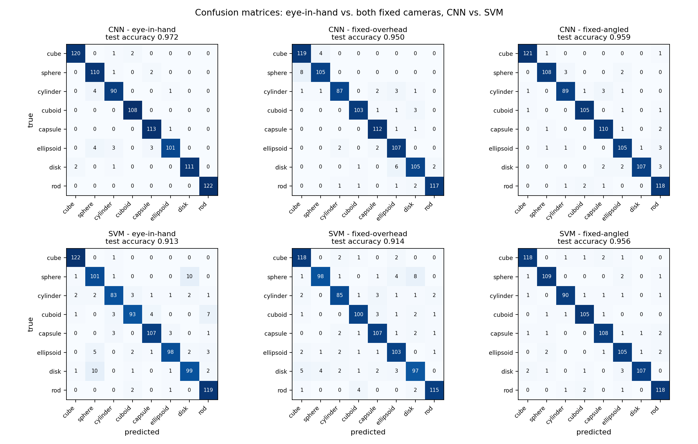
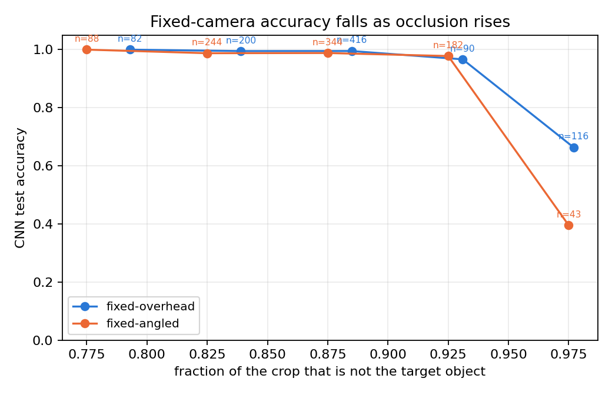
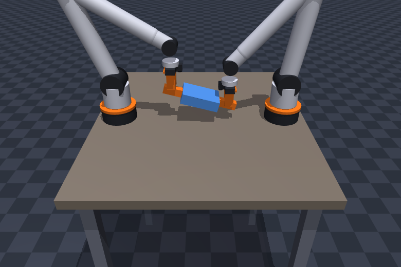

# Eye-in-Hand Claw: Measuring the Accuracy Cost of a Fixed Camera


A simulated 6-DoF arm with a **two-finger claw** and a **camera mounted on the claw
itself**, benchmarked head-to-head against **two fixed-camera baselines** — one bolted
straight overhead, one bolted at a 45° angle — so the comparison answers not just "is a
fixed camera worse?" but "is *straight-down* the problem, or is *fixed* the problem?" The
arm runs a continuous inspect-and-pick cycle over a table of objects drawn from an
eight-class taxonomy designed to be genuinely hard, not the four-shape formality a
bounding-box detector already solves for free. At every inspection, all three cameras
capture the same instant, and every frame is labelled automatically from the simulator's
own object state. Two classifiers — a small CNN and a classical HOG+Hu-moment shape
descriptor pipeline feeding an SVM — are trained and cross-validated on each camera's
data, so the eye-in-hand design's advantage is a measured number, not an assumption.

## Why not just use a fixed camera?

The standard laboratory setup mounts a **fixed camera above the workspace** and does object
detection from it. It works, but it has three structural weaknesses, and all three get
worse exactly when the robot is doing its job:

1. **The arm occludes its own target.** As the manipulator reaches in, it comes between
   the fixed camera and the object. The view degrades precisely at the moment the robot
   needs it most.
2. **It requires hand-eye calibration.** Detections arrive in camera coordinates and have
   to be transformed into the robot's frame. That transform has to be measured, and it
   drifts whenever the camera or the robot is moved or knocked.
3. **One viewpoint, fixed forever.** Object scale and pose in the image are dictated by
   where the camera happens to be bolted, not by what would make the object easiest to
   recognise. A flat object seen edge-on from above stays edge-on.

Mounting the camera **on the claw** removes all three. The robot sees each object from its
own perspective, from the approach direction, at the moment it commits to picking it up —
so it *sees what it picks, every time*. There is nothing to calibrate, because the camera
is rigidly fixed to the tool frame and its pose is a known function of the joint angles.
And the viewpoint is chosen by the controller: the arm can move to whatever standoff
distance and angle makes recognition easiest.

But weakness #1 (occlusion) and weakness #3 (fixed apparent scale) both plausibly depend
on the camera's *mounting angle*, not just on it being fixed — a straight-down "ceiling"
camera is not how most real fixed cameras are actually mounted; a corner-mounted,
45°-angled "security camera" view is far more typical, and might suffer less occlusion,
more occlusion, or about the same. Rather than assume, this repository adds that camera
too and measures it the same way.

The trade for the eye-in-hand design is that classification becomes harder. With a fixed
camera the viewpoint is constant and the classifier only has to handle object variation.
With an eye-in-hand camera the viewpoint is a function of the robot's own configuration,
so scale, viewing angle and occlusion all change as the arm moves. **This repository
measures that trade directly**: all three cameras are simulated side by side, all three
feed the same two classifiers, and the result is a real accuracy gap — actually two gaps,
one per fixed baseline — not an assumption (see
[Classification Benchmark](#classification-benchmark)).


*The claw hovering over an object, with its own camera view live in the panel on the
right. Both finger pads frame the object; the status readout names what the optical axis
is currently pointing at.*

---

## Key Numbers

**Classification benchmark** (6,000 paired frames, 70/15/15 split, 5-fold CV on
train+val, all numbers on the 900-frame held-out test set):

| Camera | Model | 5-fold CV accuracy | Test accuracy | Test macro-F1 |
|---|---|---|---|---|
| Eye-in-hand | CNN | 0.9598 ± 0.0026 | **0.9722** | 0.9712 |
| Eye-in-hand | SVM (HOG+Hu) | 0.9002 ± 0.0042 | 0.9133 | 0.9116 |
| Fixed-overhead | CNN | 0.9329 ± 0.0069 | 0.9500 | 0.9497 |
| Fixed-overhead | SVM (HOG+Hu) | 0.8829 ± 0.0057 | 0.9144 | 0.9135 |
| Fixed-angled | CNN | 0.9475 ± 0.0086 | 0.9589 | 0.9585 |
| Fixed-angled | SVM (HOG+Hu) | 0.9455 ± 0.0056 | **0.9556** | 0.9555 |

**Eye-in-hand does not win outright.** For the CNN it beats fixed-overhead by
**+2.22 pp** (McNemar's p = 0.017, significant) but its lead over fixed-angled shrinks to
**+1.33 pp** and stops being significant (p = 0.141). For the SVM, eye-in-hand and
fixed-overhead are statistically tied (**-0.11 pp**, p = 1.000), and eye-in-hand is
significantly *less* accurate than fixed-angled (**-4.22 pp**, p < 0.001) — the 45°
fixed camera is the best-performing configuration for the classical pipeline. This tracks
occlusion: the fixed-overhead camera's crop is at least 95% non-object on 14.0% of
held-out frames vs. 4.8% for fixed-angled, and accuracy on those near-fully-occluded
frames collapses for every camera and model (see [Results](#results)).

**Simulation and data pipeline:**

| Quantity | Value |
|---|---|
| Manipulator | 6-DoF revolute arm + parallel two-finger claw |
| Claw | 80 mm open, 40 mm stroke per finger, force-limited position control |
| Inverse kinematics | Analytic seed + damped least squares, **6.0 mm** mean tool error |
| Optical-axis alignment | **0.66°** mean deviation from vertical while inspecting |
| Claw camera | 224 × 224 RGB, 72° FOV, rigidly mounted on the palm |
| Fixed-overhead camera | 224 × 224 RGB, 48° FOV, bolted 1.0 m above the table, never moves |
| Fixed-angled camera | 224 × 224 RGB, 55° FOV, bolted at 45° elevation, never moves |
| Object classes | 8 (cube, sphere, cylinder, cuboid, capsule, ellipsoid, disk, rod) |
| Objects per layout | 6 (of 8 classes, no repeats), on a jittered 3 × 2 grid |
| Label source | Simulator's own object state — **exact, zero manual annotation** |
| Eye-in-hand auto-label agreement | **99.1%** (5,945/6,000) against its own segmentation |
| Grasp success (selftest) | **6/6** objects gripped and lifted clear of the table |
| Eye-in-hand target centring | **16.2 px** mean offset from image centre (of a 112 px half-width) |
| Fixed-overhead crop occlusion | mean **85.5%** of the crop is not the target object |
| Object-rolls-off-table incidents | **0/6,000** (see *Data Generation* — this was 1.48% before a friction fix) |
| Inspect-and-pick cycle | 7.65 s per object |
| Speed | 1.7 × real time on CPU |

---

## System Architecture

```
                        ┌──────────────────────────────────┐
                        │   MJCF scene (built in Python)   │
                        │  floor · table · 6-DoF arm ·     │
                        │  two-finger claw · 6 objects     │
                        └────────────────┬─────────────────┘
                                         │
        ┌────────────────────────────────┼────────────────────────────────┐
        │                                │                                │
┌───────▼────────┐              ┌────────▼────────┐            ┌──────────▼─────────┐
│ Grasp planner  │              │ MuJoCo physics  │            │ Interactive viewer │
│ longest axis → │              │ step @ 500 Hz   │            │ orbit · zoom · pan │
│ claw yaw       │              │                 │            │ + claw-POV panel   │
│ 2nd axis →     │              └────────▲────────┘            └────────────────────┘
│ finger opening │                       │
└───────┬────────┘                       │
        │                                │
┌───────▼────────────────────┐           │
│ Cycle controller           │           │
│ approach → settle →        │  ctrl     │
│ descend → close → lift →   │───────────┘
│ hold → lower → release →   │  (6 joint + 2 finger setpoints)
│ retreat                    │
└───────┬────────────────────┘
        │                    ▲
        │  Cartesian goal    │ joint angles
        └────────────────────┤
                    ┌────────┴─────────┐
                    │ Inverse kinematics│
                    │ analytic seed +   │
                    │ DLS polish (6D)   │
                    └───────────────────┘
                                         │  arm configuration
                                         ▼
                        ┌──────────────────────────────────┐
                        │  Claw camera (eye-in-hand)       │
                        │  pose = f(joint angles)          │
                        └────────────────┬─────────────────┘
                                         │
                ┌────────────────────────┴────────────────────────┐
                │                                                 │
       ┌────────▼────────┐                              ┌─────────▼─────────┐
       │  RGB  224×224   │                              │ Segmentation map  │
       │  → frame_N.png  │                              │ → centre-patch    │
       └────────┬────────┘                              │   ground truth    │
                │                                       └─────────┬─────────┘
                └──────────────────┬──────────────────────────────┘
                                   ▼
              data/captures/eye_in_hand/  +  labels.jsonl
   (image, class_id, pose, hover height, centring error, auto-label agreement)
```

**Paired against two fixed baselines.** At the same simulated instant, two more
bolted-down cameras capture the workspace — one straight overhead, one at a 45° angle —
see [Classification Benchmark](#classification-benchmark) for how that pairing turns into
two measured accuracy gaps:

```
        (arm wherever it was left           (arm now hovering over the
         from the previous inspection)       target, as diagrammed above)
                    │                                    │
     ┌──────────────┴───────────────┐                    │
     │                              │                    │
┌────▼────────────┐      ┌──────────▼───────┐            │
│ Fixed-overhead  │      │ Fixed-angled     │            │
│ camera, bolted  │      │ camera, bolted   │            │
│ 1.0 m straight  │      │ at 45° elevation,│            │
│ above the table │      │ never moves      │            │
└────┬────────────┘      └──────────┬───────┘            │
     │ crop @ the target's known 3-D position, one       │ (eye-in-hand path,
     │ fixed window size for every class (both cameras)  │  see above)
     ▼                              ▼                    ▼
data/captures/          data/captures/          data/captures/
fixed_overhead/         fixed_angled/            eye_in_hand/
+ occluded_fraction     + occluded_fraction      + centre_offset_px
     │                              │                    │
     └──────────────┬───────────────┴────────────────────┘
                    │  same frame index, same ground-truth class
                    ▼
        [ Classification Benchmark: CNN vs. SVM, 3 cameras x 2 models ]
```

---

## Run It

```bash
pip install -r requirements.txt
python run_sim.py
```

A window opens with the arm already working through the objects.

| Input | Action |
|---|---|
| Left drag | Orbit the scene |
| Right drag | Pan |
| Scroll | Zoom |
| `Space` | Pause / resume the cycle |
| `G` | Toggle pick-and-place ↔ inspect only |
| `M` | Toggle AUTO ↔ MANUAL (arm holds still) |
| `O` | Open / close the claw by hand, in MANUAL mode |
| `R` | Reshuffle the object layout |
| `C` | Save the current claw-camera frame, auto-labelled |
| `+` / `-` | Speed the cycle up or down |
| `Esc` | Quit |

Other entry points:

```bash
python run_sim.py --no-grasp       # inspect only, never pick anything up
python run_sim.py --capture        # also save a labelled frame at every inspection
python run_sim.py --ui             # MuJoCo's stock UI, with a slider per joint
python run_sim.py --dataset 6000   # headless: generate 6000 paired eye-in-hand /
                                    #           fixed-overhead frames
python run_sim.py --selftest       # verify IK, labelling and grasping
python run_sim.py --seed 7         # a different object layout
```

Then the classification benchmark itself (see
[Classification Benchmark](#classification-benchmark) for what each step does):

```bash
python -m src.train --view eye_in_hand    --model cnn
python -m src.train --view eye_in_hand    --model svm
python -m src.train --view fixed_overhead --model cnn
python -m src.train --view fixed_overhead --model svm
python -m src.evaluate
python -m src.significance         # paired McNemar's test + bootstrap CIs (Results)
python paper/build_paper.py        # regenerate the manuscript draft from results/*.json
```

And then the interactive, four-way-selectable [Live Demo](#live-demo):

```bash
python demo.py
```

---

## The Inspect-and-Pick Cycle

Each object gets the same eight-phase cycle:

| Phase | Duration | What happens |
|---|---|---|
| `approach` | 1.70 s | Traverse to the hover pose, claw open, yaw aligned to the object |
| `settle` | 0.85 s | Hold still — **the classification frame is captured here** |
| `descend` | 0.80 s | Lower the open claw around the object |
| `close` | 0.60 s | Squeeze to the planned opening |
| `lift` | 0.90 s | Raise the object 0.20 m clear of the table |
| `hold` | 0.80 s | Present it to the camera |
| `lower` | 0.90 s | Put it back |
| `release` | 0.50 s | Open |
| `retreat` | 0.60 s | Withdraw to the hover pose, move to the next object |

The classification frame is deliberately taken at `settle`, **before** the grasp. That is
the decision point for a real system — it must know what the object is in order to choose
how to grip it. It is also the only viewpoint that frames the whole object: once an
object is in the claw it sits ~56 mm from the lens and overflows the frame.

| Before the grasp (`settle`) | Held in the claw (`hold`) |
|---|---|
|  |  |
| The classification viewpoint — object centred, both pads in frame | Useful as a demo, useless as training data |


*The same cycle three phases later: the claw has closed to 51 mm on the cuboid and lifted
it clear of the table. The camera panel is now filled by the object it is holding.*

### Grasp planning

The claw closes along one axis, so it has to be yawed across the object's narrow
dimension. The planner projects each of the object's three body axes — scaled by its
half-size — onto the table plane, takes the longest projection as the object's long axis,
and yaws the claw perpendicular to it. The second-longest projection gives the width the
fingers must span, and the commanded opening is that width minus a 9 mm squeeze.

| Class | Planned opening |
|---|---|
| cube | 60 mm |
| sphere | 66 mm |
| cylinder (resting on its side) | 51 mm |
| cuboid | 52 mm |

---

## Scene

| Element | Detail |
|---|---|
| Table | 0.92 × 1.04 m surface at 0.62 m |
| Arm mount | On the table surface, at the rear edge |
| Link lengths | 0.400 m upper arm, 0.360 m forearm, 0.078 m wrist offset |
| Joint set | base yaw · shoulder · elbow · wrist roll · wrist pitch · tool yaw |
| Claw pads | 68 mm long, condim-4 contact, friction 1.8 |
| Object field | 3 × 2 grid, ±30 mm jitter, random yaw |
| Inspection height | 0.15 m (grasp frame above the table) |

### Classes

Eight classes, not four: the original four geometric primitives, plus four more added
specifically to make the task hard enough to be worth studying. Off-the-shelf detectors
(a YOLOv8 box, for instance) separate a cube from a sphere from nothing more than aspect
ratio — that is not a benchmark, it is a formality. The four additions are each a
deliberate near-miss for one of the originals under a bounding-box or convex-hull
shortcut: a **capsule** reads as "a cylinder with soft edges," an **ellipsoid** as "a
stretched sphere," a **disk** as "a cube seen from directly above," a **rod** as "a
cuboid seen edge-on." A classifier that has only learned coarse aspect ratio should
confuse these pairs; one that has learned actual silhouette curvature and proportion
should not.

| id | Class | Geometry | Dimensions (m) | Confusable with |
|---|---|---|---|---|
| 0 | `cube` | box | 0.060 × 0.060 × 0.060 | disk (face-on) |
| 1 | `sphere` | sphere | r = 0.033 | ellipsoid |
| 2 | `cylinder` | cylinder | r = 0.028, h = 0.080 | capsule |
| 3 | `cuboid` | box | 0.120 × 0.052 × 0.040 | rod (edge-on) |
| 4 | `capsule` | capsule | r = 0.026, h = 0.070 | cylinder |
| 5 | `ellipsoid` | ellipsoid | 0.026 × 0.026 × 0.042 | sphere |
| 6 | `disk` | cylinder (short, wide) | r = 0.032, h = 0.020 | cube (face-on) |
| 7 | `rod` | box (long, thin) | 0.130 × 0.024 × 0.024 | cuboid (edge-on) |

**Colour is sampled independently of class.** A cube may be red, green or purple with
equal probability, so a classifier cannot reach high accuracy by learning colour — shape
is the only class-carrying signal. This is a deliberate design decision: colour shortcuts
are one of the most common ways a tabletop-classification result fails to survive contact
with real data.

**A physics bug this taxonomy exposed, and fixed.** Capsules and ellipsoids are rounded
enough that they do not reliably tip over from an upright drop the way a flat-ended
cylinder does — and the rolling friction already raised to stop spheres and cylinders
rolling off the table (see [Data Generation](#data-generation)) damps out what little
rocking there is before it can complete a tip. Verified directly by checking settled
orientation: both classes sat with their long axis exactly vertical, every time, across
every seed tested. Rather than fight that with even more friction tuning, both classes
are now spawned already lying on their side — sidestepping the stability question
instead of depending on it (`run_sim._spawn_quaternion`).

---

## Data Generation

Every captured frame's ground-truth label comes from the **simulator's own object
state** at the moment of capture — which object slot the arm is currently inspecting —
not from a downstream detector or human annotator. This matters for the two fixed cameras
in particular: the whole point of the comparison is that the manipulator sometimes sits
between one of them and the object, so the label has to stay correct on exactly the
frames where the object is what is occluded.

```bash
python run_sim.py --dataset 6000
```

writes three paired datasets, one per camera, sharing the same frame index and class:

```
data/captures/eye_in_hand/      frame_00000.png  224×224 RGB, claw camera
data/captures/fixed_overhead/   frame_00000.png  224×224 RGB, cropped from the overhead camera
data/captures/fixed_angled/     frame_00000.png  224×224 RGB, cropped from the 45° camera
                                 labels.jsonl     one JSON record per frame, per directory
```

**Eye-in-hand.** Full 224×224 claw-camera frame. Cross-checked against its own
segmentation buffer as a pipeline sanity check (not the training label): across 6,000
frames, that independent check **agrees with the ground truth 99.1% of the time**
(5,945/6,000). Record:

```json
{"file": "frame_00000.png", "class_id": 1, "class_name": "sphere",
 "colour_rgb": [0.86, 0.22, 0.22], "object_xyz": [0.453, 0.192, 0.650],
 "image_size": [224, 224], "layout_seed": 42, "view": "eye_in_hand",
 "hover_height_m": 0.1178, "centre_offset_px": [15.7, -7.5],
 "auto_label_agrees": true}
```

`centre_offset_px` records how far the labelled object's centroid sits from the image
centre. Across the full 6,000-frame dataset: **mean 14.1 px, median 12.3 px, max
113.7 px**, against a 112 px half-width.

**Fixed-overhead and fixed-angled.** Both captured *before* the arm moves to the
eye-in-hand pose — i.e. from wherever the arm happens to be left over from the previous
inspection, exactly how a real fixed camera would be used, rather than manufacturing
worst-case occlusion on every frame. Both are cropped around the target's known 3-D
position, projected into their respective camera with a pinhole model
(`SimCamera.project`, which is orientation-agnostic — the same code handles the
straight-down and the 45° camera identically), using **one fixed window size for every
class, shared by both cameras** (sized from the largest class's full 3-D bounding radius
plus 30% margin, so it stays correct for the angled view, which can foreshorten any of an
object's three dimensions depending on its resting orientation) rather than a size fitted
to whichever object is there — a real fixed camera has no way to know the class before
classifying it, so a class-conditioned crop would leak the answer. Record (fixed-angled
shown; fixed-overhead is identical apart from `view`):

```json
{"file": "frame_00000.png", "class_id": 1, "class_name": "sphere",
 "object_xyz": [0.453, 0.192, 0.650], "image_size": [224, 224], "layout_seed": 42,
 "view": "fixed_angled", "hover_height_m": 0.1178, "occluded_fraction": 0.8654}
```

`occluded_fraction` is the share of that window that is *not* the target object —
whether that's the manipulator in the way, a neighbouring object, or bare table — read
directly from the (un-cropped) segmentation buffer over the same box.

| | mean | median | min | max | frames ≥95% occluded |
|---|---|---|---|---|---|
| Fixed-overhead | 88.8% | 89.5% | 76.8% | 100% | 14.5% |
| Fixed-angled | 87.0% | 87.6% | 74.9% | 100% | 5.1% |

The angled camera is measurably less often *fully* blocked than the straight-down one
(5.1% of frames vs. 14.5%) — when the arm hovers directly above an object, it sits
directly between that object and a straight-down camera far more often than it sits
directly between the object and a camera looking in from the side at 45°. This is the
first piece of evidence that mounting *angle*, not just being fixed, matters — see
[Results](#results) for whether it survives into classifier accuracy.



*The same instant, all three cameras, all eight classes. The fixed-camera window is the
same physical size regardless of class, so a sphere or ellipsoid fills far less of it than
a rod or cuboid — the "object scale dictated by where the camera is bolted" problem made
visible. Capsules and ellipsoids lying flat, not standing on end, confirm the spawn-pose
fix described below.*



*The motivating failure mode, caught directly: at the instant the eye-in-hand camera
frames this capsule cleanly, the fixed-overhead camera's view is entirely the arm's
forearm (100% occluded) — and the fixed-angled camera, looking in from the side, still
catches a partial, recognisable view (84% occluded) of the same object at the same
instant.*

Viewpoint is varied per frame — inspection height sampled over 0.11–0.18 m, claw yaw
perturbed by ±0.4 rad, target jittered ±15 mm — so the same object is seen at a range of
scales and orientations. The layout is reshuffled every 12 frames.

Class distribution across the 6,000-frame dataset used for the benchmark (seed 42):

| Class | Frames | Share |
|---|---|---|
| cube | 820 | 13.7 % |
| sphere | 752 | 12.5 % |
| cylinder | 637 | 10.6 % |
| cuboid | 717 | 11.9 % |
| capsule | 760 | 12.7 % |
| ellipsoid | 739 | 12.3 % |
| disk | 762 | 12.7 % |
| rod | 813 | 13.6 % |

The distribution is close to uniform (an ideal 8-way split is 12.5% each) because classes
are sampled — 6 of the 8 per layout, without replacement — per layout slot, and every
class appears in roughly the same share of layouts across many reshuffles; no rebalancing
is applied at dataset-assembly time.

### A data-integrity bug found and fixed: objects rolling off the table

An earlier version of the scene used MuJoCo's default-scale rolling friction for the
object-table contact. Spheres and (side-resting) cylinders — the two rollable classes —
could be nudged by the arm sweeping nearby, and over enough layout reshuffles a nudge
would occasionally send one rolling far enough to leave the table edge entirely and land
on the floor, well outside the camera's field of view. The bug was silent: nothing in the
capture pipeline errored, it just produced a crop or a claw-camera frame of an object that
was no longer there, labelled with that object's class.

Scanning a generated dataset for objects resting at floor height rather than table height
(`object_xyz[2]` far below `TABLE_TOP_Z`) found **89 of 6,000 frames (1.48%) affected —
71 cylinders and 18 spheres, zero cubes or cuboids**, as expected for a rolling-specific
failure. Within just the affected classes, that is roughly 5–6% of their frames silently
mislabelled — enough to matter for a benchmark that specifically studies per-class
accuracy.

The fix raises `OBJECT_FRICTION`'s rolling and torsional coefficients by roughly an order
of magnitude (`(1.0, 0.05, 0.002)` → `(1.0, 0.08, 0.02)`), which stops objects from rolling
far when nudged without visibly changing how they sit or how the claw grips them —
confirmed by an unchanged `6/6` grasp success in `--selftest`. A runtime check
(`_on_table`) was also added as a safety net: if a drawn object is ever found off the
table, the sampler redraws, and if every object in the layout has ended up off-table it
reshuffles rather than capture a bad frame. A 2,000-frame regeneration after the fix found
**zero** incidents. Every number in this README and in `results/` is from the corrected
pipeline.

### A second bug the friction fix caused: capsules and ellipsoids stuck standing up

Adding capsule and ellipsoid to the taxonomy exposed a side effect of the fix above.
Both are spawned with a random yaw only (the same code path that lets a flat-ended
cylinder settle correctly), on the assumption that gravity would topple them onto their
side the way it does a tall, flat-ended cylinder. It didn't. Checking their settled
orientation directly (the world-frame angle of each object's long axis from vertical)
showed both classes standing perfectly upright — 90° tilt from lying flat, i.e. 0° from
vertical — on **every seed tested**, not just occasionally.

The mechanism: a flat-ended cylinder balanced on end is only *metastably* upright — its
flat contact patch offers no restoring force, so the smallest numerical asymmetry in the
contact solver tips it over. A rounded end resting on a single point is different: any
small rocking motion generates a friction-damped restoring torque back toward vertical,
and the rolling friction raised specifically to stop spheres and cylinders rolling away
damps that rocking out before it can complete a full tip. The two fixes are in tension —
friction tuned to stop one failure mode locks in a different one for a different shape.

Rather than tune friction further and risk trading one class-specific failure for
another, both classes are now spawned already lying on their side (`_spawn_quaternion`,
`LYING_ON_SIDE_CLASS_IDS`), sidestepping the stability question rather than depending on
physics to resolve it. Re-checked across 12 seeds after the fix: both classes settle at
exactly 90° tilt (lying flat) and the expected height above the table, every time.
Dataset generation itself (which only hovers to inspect, never grasps) was **never
affected** — the corrupted upright pose only showed up in the interactive viewer's full
pick-and-place cycle, where grasping and lifting neighbouring objects can knock a
standing capsule around before its own turn comes up. A 2,000-frame dataset regeneration
after the fix, scanned the same way as the table-fall bug above, found zero fallen or
off-field objects of any class.

---

## Verification

`python run_sim.py --selftest` drives the claw over every object in turn, inspects it,
then grips and lifts it — reporting tool accuracy, label agreement and grasp success:

```
    rod       pos err   4.8 mm | axis 0.57 deg | sees rod        OK  | grasp width 24.0 mm, lifted +175.4 mm OK
    ellipsoid pos err   4.9 mm | axis 0.60 deg | sees ellipsoid  OK  | grasp width 43.2 mm, lifted +167.5 mm OK
    cylinder  pos err   5.7 mm | axis 0.66 deg | sees cylinder   OK  | grasp width 51.0 mm, lifted +167.8 mm OK
    capsule   pos err   9.3 mm | axis 0.87 deg | sees capsule    OK  | grasp width 52.0 mm, lifted +167.3 mm OK
    cube      pos err   3.1 mm | axis 0.44 deg | sees cube       OK  | grasp width 60.0 mm, lifted +164.8 mm OK
    disk      pos err   8.3 mm | axis 0.82 deg | sees disk       OK  | grasp width 64.0 mm, lifted +172.7 mm OK

  mean IK position error : 6.0 mm
  mean optical-axis error: 0.66 deg
  auto-label agreement   : 6/6
  successful grasps      : 6/6
```

The residual few millimetres are steady-state tracking error of the position-controlled
joints under gravity, not IK error — the IK solution itself converges to under 0.1 mm.

### Two problems that were worth solving properly

**The IK gets trapped without a good seed.** A naive damped-least-squares solver seeded
from the current pose runs into the elbow joint limit for most targets in this workspace:
it converged to ~194 mm mean error and left the optical axis 60° off vertical. The solver
here first computes a **closed-form seed** — with the optical axis constrained to vertical,
the arm reduces to a planar 2R chain plus a wrist pitch that absorbs the remaining angle —
and evaluates both elbow branches and both wrist branches, polishing each with DLS and
keeping the best. Later solves warm-start from the previous solution, which keeps the
per-step cost low enough to run above real time.

**A side-mounted camera only centres objects at one height.** The camera sits 36 mm to
one side of the palm and is tilted back towards the tool axis, so its optical axis crosses
that axis at exactly one depth. Hovering straight above an object therefore centres it at
one inspection height and nowhere else — at 0.24 m the target drifted 32 mm off axis.
Instead of hovering above the object, the controller solves for the lateral offset that
puts the object *on* the optical axis at the current height, and undoes that offset before
descending so grasping is unaffected. Centring error dropped from tens of millimetres to
a mean of 3.2 px across inspection heights from 0.13 m to 0.24 m.

---

## Classification Benchmark

Two classifiers, trained identically on all three camera views, so the only thing that
differs between an "eye-in-hand" run, a "fixed-overhead" run and a "fixed-angled" run is
which camera produced the image:

1. **CompactCNN** — a 4-block convolutional network (16→32→64→128 channels, batch-norm +
  ReLU + max-pool per block, global average pool, linear head) trained from scratch on
  96×96 RGB. Eight geometric primitives distinguished mainly by silhouette do not need a
  pretrained ImageNet backbone whose learned features have nothing to do with this scene.
2. **HOG + Hu-moment SVM** — a classical shape-descriptor pipeline: a 64×64 grayscale
  HOG descriptor (edge-orientation histogram) concatenated with seven log-scaled Hu
  moments of the object's silhouette, standardised and fed to an RBF-kernel SVM. The
  silhouette is isolated by Otsu-thresholding the HSV **saturation** channel — every
  object is drawn from a saturated colour palette while the table and most of the arm
  are desaturated greys and steel tones by construction (see [Scene](#scene) →
  *Classes*), so this segmentation needs no class-specific tuning. The claw's orange
  accent trim is the exception (see [Limitations](#limitations--future-work)).

**Protocol.** Each 6,000-frame view is split **70/15/15** (train/val/test), stratified by
class, with a fixed seed. Train+val (5,100 frames) is used for **5-fold stratified
cross-validation** — a fresh model trained per fold — to report a mean ± std that a
single train/test split cannot. A final model is then fit on the full 5,100 and evaluated
**once** on the 900-frame held-out test set, which no amount of cross-validation or
hyperparameter search ever touches. Because all three views are paired frame-for-frame
with an identical class-label sequence, this split produces the **same 900 held-out frame
indices** for every camera — which is what licenses the paired significance tests below.
The SVM's `C` and `gamma` were chosen by a 5-fold grid search **on the eye-in-hand
training split only** and reused as-is for both fixed cameras, so neither fixed view's
result is a baseline tuned against it (exact values in [Results](#results) —
`src/model.py`'s docstring keeps the search on record).

**A methodology note, kept because it's the kind of thing that quietly invalidates a
benchmark.** The first CNN training recipe (10 epochs/fold, fixed learning rate) produced
5-fold accuracies ranging from **0.58 to 0.94 on identical hyperparameters** — an
under-trained model, not a property of the data, and on the fixed-overhead view it fit the
cross-validation folds while collapsing on the untouched test set. Both symptoms
disappeared after switching to a cosine-annealed learning rate, gradient clipping, and
more epochs (18/fold, 25 for the final fit): fold accuracies tightened substantially and
the CV/test gap closed. All numbers below are from the corrected recipe, run on the
corrected (friction-fixed, capsule/ellipsoid-spawn-fixed) dataset; `src/train.py`'s
docstring keeps the failure mode on record.

---

## Results

| Camera | Model | 5-fold CV accuracy | Test accuracy | Test macro-F1 |
|---|---|---|---|---|
| Eye-in-hand | CNN | 0.9598 ± 0.0026 | **0.9722** | 0.9712 |
| Eye-in-hand | SVM | 0.9002 ± 0.0042 | 0.9133 | 0.9116 |
| Fixed-overhead | CNN | 0.9329 ± 0.0069 | 0.9500 | 0.9497 |
| Fixed-overhead | SVM | 0.8829 ± 0.0057 | 0.9144 | 0.9135 |
| Fixed-angled | CNN | 0.9475 ± 0.0086 | 0.9589 | 0.9585 |
| Fixed-angled | SVM | 0.9455 ± 0.0056 | **0.9556** | 0.9555 |

**Eye-in-hand does not win outright.** It beats fixed-overhead by +2.22 pp with the CNN,
but its lead over fixed-angled shrinks to +1.33 pp with the CNN, and with the SVM it is
statistically tied with fixed-overhead and significantly *behind* fixed-angled (-4.22 pp)
— see *Statistical significance* below for the p-values behind each of these four
comparisons.

Per-class F1 on the held-out test set (900 frames, 8 classes):

| | cube | sphere | cylinder | cuboid | capsule | ellipsoid | disk | rod |
|---|---|---|---|---|---|---|---|---|
| Eye-in-hand CNN | 0.98 | 0.95 | 0.94 | 0.99 | 0.97 | 0.94 | 0.99 | 1.00 |
| Eye-in-hand SVM | 0.98 | 0.87 | 0.89 | 0.89 | 0.94 | 0.91 | 0.87 | 0.93 |
| Fixed-overhead CNN | 0.95 | 0.94 | 0.94 | 0.97 | 0.97 | 0.93 | 0.93 | 0.97 |
| Fixed-overhead SVM | 0.93 | 0.91 | 0.90 | 0.92 | 0.93 | 0.91 | 0.86 | 0.95 |
| Fixed-angled CNN | 0.98 | 0.96 | 0.94 | 0.97 | 0.96 | 0.94 | 0.96 | 0.94 |
| Fixed-angled SVM | 0.96 | 0.96 | 0.96 | 0.96 | 0.95 | 0.93 | 0.96 | 0.96 |



*5-fold CV accuracy (bars, ± 1 std) against held-out test accuracy (diamonds) for all six
combinations. The CV estimate and the test point agree closely everywhere.*



*Row-true, column-predicted, raw counts, all six combinations. The classical near-miss
classes (capsule/cylinder, ellipsoid/sphere, disk/cube, rod/cuboid) carry most of the
off-diagonal mass, confirming the eight-class taxonomy forces genuine shape
discrimination rather than a bounding-box shortcut.*



*Binning each fixed camera's CNN held-out predictions by `occluded_fraction` shows
accuracy falling as the crop fills with everything except the object, for both fixed
cameras — direct, per-sample evidence for the mechanism behind both accuracy gaps.
Accuracy on frames that are at least 95% non-object drops to 69.0% (fixed-overhead CNN),
39.5% (fixed-angled CNN), 56.3% (fixed-overhead SVM), and 32.6% (fixed-angled SVM), versus
97–99% on less-occluded frames for every camera/model pair.*

### Statistical significance

All three views share the identical 900 held-out test frame indices (see *Protocol*
above), which licenses a **paired** analysis for each fixed camera against eye-in-hand —
more powerful than comparing two independent accuracies, because it asks "on the
instances where the two views disagree, which one is usually right?" rather than "are
these two numbers different?" (`src/significance.py`):

| Fixed camera | Model | Eye-in-hand acc. [95% CI] | Fixed acc. [95% CI] | Gap [95% CI] | McNemar's p |
|---|---|---|---|---|---|
| Fixed-overhead | CNN | 0.9722 [0.9611, 0.9822] | 0.9500 [0.9356, 0.9644] | +0.0222 [+0.0044, +0.0389] | **0.017** |
| Fixed-overhead | SVM | 0.9133 [0.8956, 0.9311] | 0.9144 [0.8956, 0.9322] | -0.0011 [-0.0267, +0.0256] | 1.000 |
| Fixed-angled | CNN | 0.9722 [0.9611, 0.9822] | 0.9589 [0.9456, 0.9711] | +0.0133 [-0.0033, +0.0300] | 0.141 |
| Fixed-angled | SVM | 0.9133 [0.8956, 0.9311] | 0.9556 [0.9422, 0.9689] | -0.0422 [-0.0644, -0.0200] | **<0.001** |

Confidence intervals are 10,000-resample bootstraps; McNemar's test is the exact binomial
form on the discordant pairs. **We report all four comparisons, not just the two that
happen to favour eye-in-hand** — a benchmark that only reports favourable comparisons is
not a useful benchmark.

**Reading the result honestly:** eye-in-hand is significantly ahead of fixed-overhead with
the CNN, but that lead is smaller and not significant against fixed-angled, and for the
SVM eye-in-hand is tied with fixed-overhead and significantly *behind* fixed-angled. The
comparison between the two fixed cameras is the result most specific to this repository's
design: the fixed-angled camera reaches ≥95% occlusion on far fewer held-out frames than
fixed-overhead (4.8% vs. 14.0%, consistent with the full-dataset numbers in
[Data Generation](#data-generation)), and because both classifiers do badly on those
near-fully-occluded frames, a camera that lands there less often keeps more of its overall
accuracy. This affects the SVM's total accuracy more than the CNN's, since the SVM already
loses more ground on occluded frames even before the occlusion rate is factored in — which
is why the fixed-angled camera can match or beat eye-in-hand for the SVM specifically. The
overall picture is that **mounting angle, not fixedness by itself, accounts for most of
the gap usually attributed to a fixed camera**, and eye-in-hand's advantage over a fixed
camera should not be assumed without saying which fixed camera and which classifier are
being compared.

---

## Live Demo

```bash
python demo.py
```

opens the same inspect-and-pick simulation as `run_sim.py`, but with the picture-in-picture
panel wired to whichever trained checkpoint you select, so every prediction on screen is a
live forward pass through the actual model on the actual current camera frame — not a
replay. Requires the six `checkpoints/*_cnn.pt` / `*_svm.joblib` files from
[Classification Benchmark](#classification-benchmark) to already exist.

| Key | Action |
|---|---|
| `V` | Switch camera: eye-in-hand → fixed-overhead → fixed-angled → ... |
| `N` | Switch model: CNN ↔ SVM |
| `Space` | Pause / resume |
| `G` | Grasp on / off |
| `R` | Reshuffle the object layout |
| `+` / `-` | Speed up / slow down |
| `Esc` | Quit |

The panel shows exactly what the selected model receives: the raw claw-camera frame for
eye-in-hand, or the full fixed-camera view with a **green box** outlining the fixed
170 mm crop window for fixed-overhead or fixed-angled — the same "one window size for
every class" limitation visualised in [Data Generation](#data-generation), live. An
on-screen readout gives the prediction, its confidence, the ground truth, and a running
session accuracy, tallied once per object at the same `settle`-phase decision point the
benchmark's training data used — so a demo run's accuracy is directly comparable to the
numbers in [Results](#results). Switching camera or model resets the tally, so each
combination's accuracy is judged on its own run, not a mix of the last six.

One honesty note carried over from the checkpoints themselves: the CNN's on-screen number
is a true softmax probability; the SVM was not fit with `probability=True` (see
`src.model.build_svm_pipeline`), so its number is a softmax over one-vs-rest
decision-function margins — a reasonable live indicator of confidence, but not a
calibrated probability, and the demo labels it as such.

---

## Search-and-Pick Demo

```bash
python search_and_pick.py
```

A second, independent demo (`search_and_pick.py` + `perception.py`) that removes the one
piece of ground truth every other script in this repository still relies on: where the
object is. `ScanController` (used by `run_sim.py`, `demo.py` and the classification
benchmark) reads each object's true position directly off the simulator state to decide
where to move. This demo's arm is never told where anything is. Instead it:

1. **Searches** the table with its own eye-in-hand camera, sweeping a raster of
   waypoints over the known *workspace* extent (a fixed property of the hardware, like
   the table's own size — not per-object information) until it sees a candidate object.
2. **Confirms** the candidate by moving directly above its rough position and looking
   again, the same "settle and look" pose the classification benchmark already trusts.
3. **Localises** it in 3-D from a single RGB-D-style view (`perception.detect`): a
   segmentation-plus-depth back-projection stands in for a real depth camera (an
   `enable_depth_rendering()` render, not a privileged position lookup), and an
   image-moments principal axis stands in for a real grasp-orientation estimator. The
   only "ground truth" used at all is which geoms belong to a free-floating body (i.e.
   could be a pick target) versus the robot, table or basket — computed once from the
   model's own joint structure, the same distinction a real system gets for free from its
   own URDF, never from where anything currently sits.
4. **Grasps** it, then checks the *gripper's own joint encoder* (`Workspace.claw_gap`) —
   not vision again — to confirm something is actually between the finger pads before
   lifting, and re-checks it after lifting and after carrying, so a slip is caught rather
   than silently reported as a success.
5. **Carries** it to a basket at a fixed, known location (infrastructure, like the
   robot's own base — not a pick target) and releases it.
6. **Resumes searching** for the next object, until a full sweep turns up nothing.

| Key | Action |
|---|---|
| `SPACE` | Pause / resume |
| `R` | Reshuffle the object layout and start over |
| `+` / `-` | Speed up / slow down |
| `Esc` | Quit |

**Honest results, not a claimed 100%.** Across repeated runs over several seeds, the
controller reliably *finds* and *grasps* every object on the table — the gripper encoder
confirms contact before every lift, and a full sweep always attempts all six — but not
every grasped object stays in the basket: a full six-object sweep typically ends with
2–5 of the 6 objects actually inside it (roughly 3.5/6 on average), varying run to run.
Tracing the failures down to individual physics steps (logging every free body's velocity
every step, not just at phase boundaries) found the dominant mechanism was not the grasp
itself: after releasing an object into the basket, the very next search move used to
originally climb back to search altitude *while already moving sideways* toward the next
waypoint — a diagonal path that, starting right next to the basket at the low release
height, could clip an object still settling from the previous drop and launch it off the
table entirely. Fixed by always rising straight up to search altitude before moving
laterally (see `_go_to_next_waypoint`), which measurably improved but did not eliminate
the failure rate — a second, less common mechanism (an inaccurate width estimate causing a
too-fast, too-hard claw closure) remains. Also reduced: the basket's release height (less
drop energy per placement) and the arm's IK solver's tendency to jump between equally
valid but discontinuous elbow/wrist branches on consecutive control ticks (a latent
property of `ArmKinematics.solve`'s existing multi-start fallback that the classification
benchmark's own point-to-point motion never stressed, since it doesn't sweep continuously
through many nearby targets the way this demo's search pattern does — verified not to
change the benchmark's own numbers, `python run_sim.py --selftest`). See
[Limitations & Future Work](#limitations--future-work) for what's left.

**The "objects collected" counter itself used to be wrong, not just the physical success
rate.** It originally incremented the instant the claw released — which is not the same
claim as "the object is in the basket," and for a while the two silently diverged. Fixed
with a real check: `SearchAndPlaceController` now looks at the basket's own footprint
through a fixed camera before and after every release (`_basket_masked_area`) and only
counts a pick if the occupied pixel area measurably increased. Counting *distinct*
objects instead of a raw area was tried first and rejected — objects resting close
together in a small basket routinely merge into a single contour in a 2-D view (measured:
four objects at the basket's own drop-offset spacing rendered as one blob), which would
have undercounted every pick after the first. The area check is not perfect either: it
cannot yet detect a *later* drop knocking an *earlier*, already-counted item back out of
the basket, so the reported count can still drift slightly high over a long run — a
smaller, once-per-pick gap now, rather than the original always-wrong one.

---

## Limitations & Future Work

1. **No domain randomisation.** Lighting, table texture and camera intrinsics are fixed. A
   classifier trained on this data would almost certainly not transfer to a real claw
   camera. Randomising lighting direction and intensity, surface texture, and adding
   sensor noise and motion blur is the necessary next step before any sim-to-real claim.
2. **Geometric primitives, not real objects.** Eight primitives — four of them chosen
   specifically to be confusable with the original four — prove the pipeline can measure
   a real difficulty gradient, not that it matches the task. Replacing them with scanned
   meshes of everyday objects (mug, bottle, remote, spoon) is required before the
   classification problem is representative of a real picking workcell.
3. **Clutter in frame.** At a 72° FOV and 0.13 m grid spacing, neighbouring objects appear
   at the edges of most frames. The labelled object is reliably centred (see
   `centre_offset_px`), but frames are not clean single-object crops. Recording per-frame
   bounding boxes for *every* visible object is the fix.
4. **Grasping is open-loop.** The claw closes to a width computed from ground-truth object
   geometry, which a real system would not have. Closing on force feedback, or predicting
   the opening from the camera image, is the honest version of this.
5. **Both fixed baselines are given the object's location for free.** Their crops are
   centred on the target's known 3-D position; a real fixed-camera system would need its
   own detector or localiser to find that region first, which is not modelled here. The
   reported gaps are therefore the **classification-only** cost of each fixed viewpoint —
   the true end-to-end cost, including detection failures under occlusion, is at least as
   large.
6. **The SVM's segmentation is a scene-specific shortcut, and an imperfect one.**
   Isolating the silhouette by HSV-saturation thresholding works because objects are
   saturated and most of the scene is grey by construction — except the claw's orange
   accent trim (fingers, pedestal ring), which is also saturated. On a frame where a
   finger is prominent and the object is small or occluded, the largest saturated
   contour can be the finger rather than the object, feeding the SVM a wrong shape
   descriptor for a reason that has nothing to do with the object's own class. This
   segmentation also would not survive a cluttered real background with its own
   saturated colours, so the SVM's numbers reflect what a classical pipeline can do
   *given* a working segmentation step, not the cost of building one.
7. **Sample size.** At 6,000 paired frames per view (900 held out), not every accuracy gap
   reaches conventional statistical significance under a conservative paired test — the
   eye-in-hand vs. fixed-angled gap is not significant for the CNN (p = 0.141), and the
   eye-in-hand vs. fixed-overhead gap is not significant for the SVM (p = 1.000) — see
   [Results](#results) → *Statistical significance*. A larger-scale replication, or an
   aggregated analysis across multiple random seeds, would sharpen these estimates rather
   than relying on a single 900-instance test set per camera.
8. **Rigid-body contact only.** Objects are rigid primitives with idealised friction. No
   deformables, no slip modelling.
9. **Only one angle tested for the angled baseline.** 45° is one point on a continuum
   between straight-down and eye-level; whether occlusion and accuracy vary monotonically
   with mounting angle, or 45° happens to sit at a particularly favourable or unfavourable
   point, is not established here.
10. **The search-and-pick demo's grasp isn't always retained.** The dominant cause traced
    to the arm clipping an object mid-transit while climbing back to search altitude
    after a release; a rising-before-lateral fix substantially reduced but did not
    eliminate this, and an imprecise width estimate occasionally still triggers a too-hard
    claw closure — see [Search-and-Pick Demo](#search-and-pick-demo) for the measured rate
    and what was tried.
11. **The search-and-pick demo's orientation estimate is noisy for near-symmetric shapes.**
    A disk's (or any near-circular silhouette's) principal-axis angle is close to
    undefined by construction — harmless for grasping (any yaw grips a round object), but
    a real limitation of the image-moments approach were it used for anything orientation-
    sensitive.

---

## Dual-Arm Bimanual Cooperative Manipulation

A second track built on the same arm extends the testbed from one arm to **two arms facing
each other across a shared table**, to study tasks that physically require two hands acting
on the same object at once. The arm model and inverse kinematics are not re-implemented:
`run_sim.arm_body_mjcf(prefix, base, yaw)` emits the arm under a name prefix at any base
pose, and **both** the single-arm scene and the dual-arm scene instantiate it — so the
single-arm classification benchmark above is preserved *bit-for-bit*
(`python run_sim.py --selftest` is byte-identical after the extension). Each arm is driven
by its own `ArmKinematics`, made base-yaw aware so the arm rotated 180° to face its partner
reaches the shared centre with the same sub-mm closed-form accuracy.

```bash
python dual_arm.py --selftest          # both arms reach the shared centre (headless)
python dual_arm.py                     # live viewer of the two-arm rig
python bimanual.py                     # run the two bimanual tasks headless (metrics)
python bimanual.py --view              # watch the cooperative lift live
python bimanual.py --view --desync 0.4 # watch it see-saw when the arms desynchronize
python bimanual_benchmark.py           # full benchmark -> results/ + figures/
python paper/chapter_build_latex.py --tectonic .tools/tectonic.exe   # build the chapter
```

**Task 1 — cooperative lift (a genuine two-hand task).** The payload is a *dumbbell*: a
central block wider than one gripper's open span (so one hand cannot grasp it anywhere),
with a thin graspable rod at each end. Both arms take an end and lift it in lockstep
through the shared closed kinematic chain, with a synchronization barrier (neither lifts
until both grippers confirm a grasp). Measured, over 8 jittered trials:

| Condition | Peak payload tilt | Carried level? |
|---|---|---|
| Single arm (one end rod) | **29.8°** | no — it dangles |
| **Two arms, synchronized** | **0.0° ± 0.0°** (held 8/8) | **yes** |
| Two arms, 0.4 s desynchronized | 15.1° | no — it see-saws |



*Two arms mid-lift with a 0.4 s inter-arm lag: the dumbbell see-saws (~15°). Synchronized,
it stays level.* And the degradation is smooth, not a cliff — peak tilt rises
0° → 4.1° → 8.1° → 11.7° → 15.1° → 18.0° as the lag grows from 0 to 0.5 s
([`figures/bimanual_desync_sweep.png`](figures/bimanual_desync_sweep.png)). **Coordination
quality, not arm count, sets the outcome.**

**Task 2 — closing a lid (an honest *negative* result).** The task intuition most readily
calls "two-handed" — seating a press-fit lid on a can while the other hand steadies it —
turns out **not** to require two hands: one arm seats the lid to **0.9 mm** off-centre
because the *table* back-stops the can against the press, and the naive two-arm version is
actually *worse* (the arms contend for the same can and knock it 124 mm aside). The lesson
sharpens the first result: **a second hand earns its place only when it supplies a
constraint neither the first hand nor the world can** — which the oversized-payload lift
needs (nothing holds a payload in flight) and the lid close does not.

The full write-up is a Springer-style book chapter generated the same build-from-data way
as the paper above: [`paper/chapter.pdf`](paper/chapter.pdf) (sources in
`paper/chapter/`, zipped as `paper/chapter_latex.zip`), with every number read from
`results/bimanual_results.json`.

---

## Where This Fits

The end goal is a manipulator that identifies objects using only the sensors carried on
the robot itself, and acts on that identification — no external camera rig, no hand-eye
calibration step, no separate perception station.

This repository builds that loop end to end and closes it: a camera that moves with the
arm, exact ground truth for supervision, a grasp planned from the recognised object's
geometry, and — the part that used to be missing — a measured answer to whether the
eye-in-hand design is worth its cost, against not one but two independent fixed-camera
baselines under the same classifiers, the same synthetic objects, and the same 5-fold
cross-validated, held-out-tested, paired-significance-tested protocol.

The answer is not a clean win for eye-in-hand. It beats fixed-overhead significantly with
the CNN (+2.22 pp, p = 0.017), but that lead shrinks and stops being significant against
fixed-angled (+1.33 pp, p = 0.141); with the SVM it is statistically tied with
fixed-overhead (p = 1.000) and significantly *behind* fixed-angled (-4.22 pp, p < 0.001).
The gap between the two fixed cameras traces to a measured cause, not an assumed one: the
fixed-angled camera reaches near-full occlusion on far fewer frames than fixed-overhead
(see [Results](#results)), and that difference matters more for the SVM, which already
loses more accuracy on occluded frames than the CNN does. Most published comparisons of
camera placement in manipulation are ablations inside a full learned policy evaluated on a
real robot, where camera placement is one of several factors that vary together and
mounting angle is rarely isolated as its own variable, in part because doing so on real
hardware means physically remounting a camera and re-collecting a dataset for each
configuration (see the Related Work section of the paper draft under `paper/`). This
repository's contribution is not a claim that eye-in-hand always wins — it does not — but a
controlled measurement showing that mounting *angle*, not fixedness by itself, is the
larger factor, cheap to isolate in simulation and expensive to isolate on a real robot.

---

## Author

**Yugandhar Kulkarni** — DRDO Research Intern · BTech CSE, DES Pune University
GitHub: [github.com/yugandhar-k](https://github.com/yugandhar-k)

---

## Reproducibility

Everything is seeded (`--seed`, default 42, threaded through `src.utils.set_seed` into
`random`, `numpy` and `torch` for the benchmark). The MJCF scene is generated in Python
rather than loaded from a static file, so link lengths, claw geometry, the object field and
the class taxonomy are all named constants at the top of `run_sim.py`. The arm's planar
link lengths and the camera mounting offsets are *measured back out of the compiled model*
when the solver and the framing correction are set up — retuning the geometry does not
silently break either.

The train/val/test split is a deterministic, class-stratified function of the seed
(`src.dataset.stratified_split`), and cross-validation folds are likewise seeded, so a
fresh `python -m src.train ...` run reproduces the same split and the same fold
assignment — though not bit-identical model weights, since `torch`'s CPU kernels are not
guaranteed deterministic across runs even with a fixed seed.

---

## Citation

A full manuscript draft — abstract, related work, method, experimental setup, results
with the significance analysis above, discussion, limitations, and references — is at
[`paper/paper.docx`](paper/paper.docx), built by `python paper/build_paper.py` directly
from the `results/*.json` files this pipeline produces, so every number in it traces back
to a specific file under `results/` rather than being hand-transcribed. Run it after the
training and evaluation commands above. It is a draft for adaptation to a specific venue's
template, not a camera-ready submission.

```bibtex
@software{kulkarni2026eyeinhand,
  author  = {Kulkarni, Yugandhar},
  title   = {Eye-in-Hand Claw: Measuring the Accuracy Cost of a Fixed
             Overhead Camera for Manipulator Object Classification},
  year    = {2026},
  url     = {https://github.com/yugandhar-k/Robotic-Arm-Vision-Testbed},
  note    = {MuJoCo simulation of a 6-DoF arm with a two-finger claw and a
             claw-mounted RGB camera, benchmarked against a fixed-overhead
             camera baseline with a CNN and an HOG+Hu-moment SVM classifier,
             5-fold cross-validated and held-out test on 6,000 paired,
             automatically-labelled frames.}
}
```
